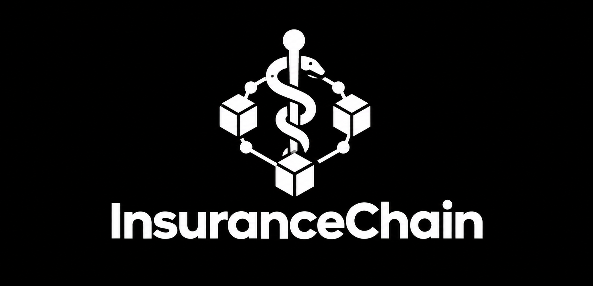
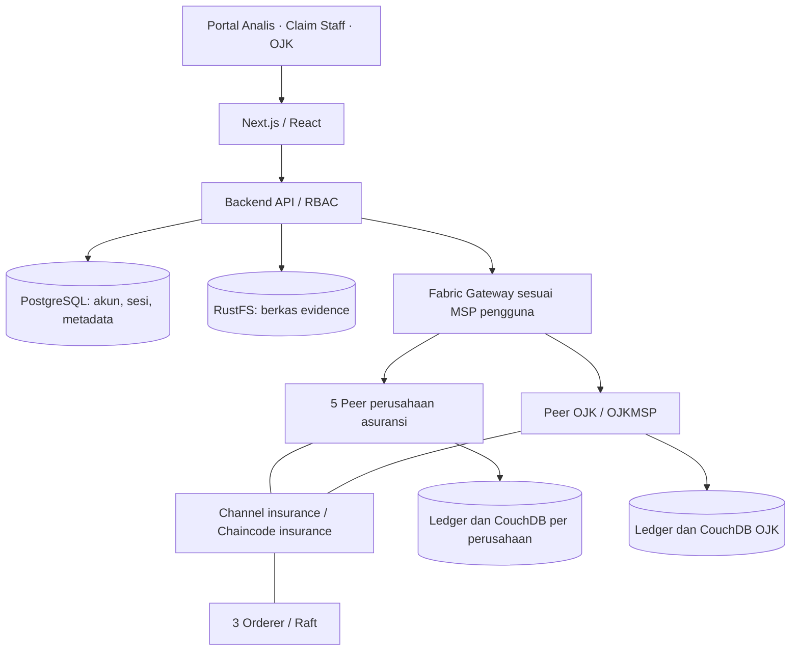
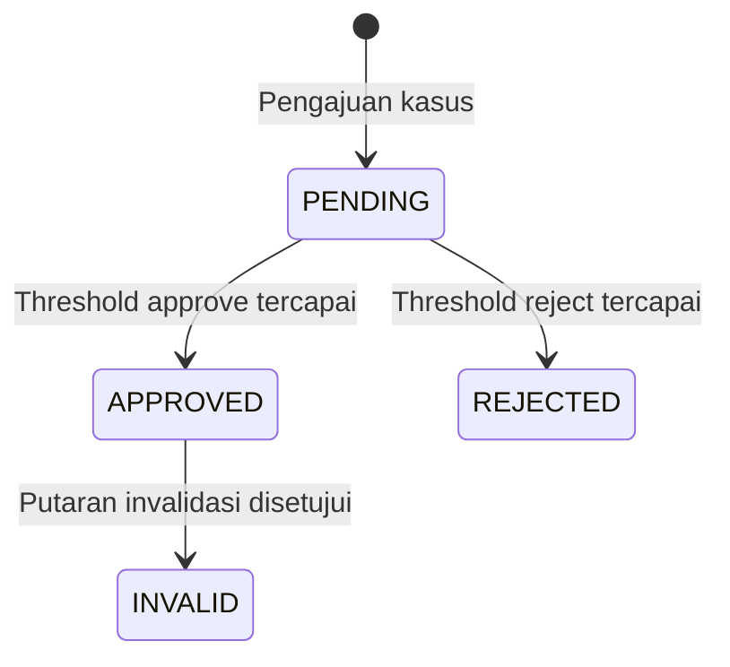

<div align="center">
  
  <h1>InsuranceChain</h1>
  <p><strong>Blockchain-based Fraud Intelligence Sharing</strong></p>
  <p>Berbagi temuan fraud, menilai bukti bersama, dan menjaga jejak keputusan lintas perusahaan asuransi.</p>
  <p>
    
    
    
    
  </p>
  <p><a href="#fitur-utama">Fitur</a> · <a href="#arsitektur">Arsitektur</a> · <a href="docs/getting-started.md">Instalasi</a> · <a href="docs/README.md">Dokumentasi</a> · <a href="CONTRIBUTING.md">Kontribusi</a></p>
</div>

---

InsuranceChain adalah proyek skripsi berupa sistem berbagi informasi fraud berbasis jaringan **Hyperledger Fabric permissioned**. Perusahaan asuransi mengajukan temuan beserta evidence, melakukan penilaian lintas organisasi, dan mencari kasus menggunakan identifier. Portal regulator menyediakan pengawasan dan governance dengan peer serta salinan ledger OJK sendiri.

Nama peran OJK menggambarkan rancangan sistem penelitian; repository ini bukan produk resmi atau layanan yang diselenggarakan OJK.

## Fitur utama

- **Tiga portal khusus:** analis, claim staff, dan regulator dengan pembatasan akses pada API maupun tampilan.
- **Dossier kasus:** kronologi, identifier, evidence dengan preview PDF/gambar/teks/CSV, dan riwayat keputusan sesuai hak akses.
- **Validasi lintas perusahaan:** satu suara per organisasi, dukungan implisit dari pengaju, serta threshold yang ditetapkan saat putaran dibuka.
- **Case invalidation:** koreksi kasus melalui pengajuan bukti dan putaran voting baru, dengan jejak historis tetap tersimpan.
- **Pencarian fraud:** banyak identifier per kasus, filter perusahaan, waktu, status, dan wilayah.
- **Dashboard geografis:** peta Indonesia yang mengarah ke pencarian sesuai wilayah, pola fraud, dan kasus terbaru.
- **Ekspor CSV:** filter dipilih melalui dialog sebelum data diekspor oleh pengguna berwenang.
- **Aktivitas blockchain:** portal OJK menampilkan tahapan proposal, endorsement, submission, dan commit dari integrasi aplikasi.
- **Identitas visual:** tema hitam, ungu, dan putih, font Poppins, serta aksen honeycomb.

## Peran pengguna

| Peran           | Portal    | Kewenangan utama                                                                                                |
| --------------- | --------- | --------------------------------------------------------------------------------------------------------------- |
| Fraud Analyst   | `/analis` | Mengajukan kasus/evidence, voting, invalidasi, pencarian, ekspor, dan mengelola claim staff organisasinya       |
| Claim Staff     | `/staff`  | Dashboard dan pencarian kasus `APPROVED` atau `INVALID`, termasuk evidence yang diizinkan                       |
| OJK / Regulator | `/ojk`    | Meninjau registrasi, mengelola status organisasi, memantau validasi/riwayat, ekspor, serta aktivitas blockchain |

Root `/` mengarah ke `/analis`. OJK tidak mengajukan kasus dan tidak mengikuti voting bisnis. Nilai klaim terkait pada dashboard ketiga peran menjumlahkan kasus berstatus `APPROVED` saja.

## Arsitektur



Frontend dan backend berjalan dalam **satu proses Next.js**. Enam peer memiliki penyimpanan ledger dan world state masing-masing. Portal OJK menggunakan gateway `peer0.ojk.insurance.local` dan menargetkan query ke `OJKMSP`; tidak ada fallback pembacaan ke peer perusahaan.

| Lapisan       | Teknologi                                                  |
| ------------- | ---------------------------------------------------------- |
| Antarmuka     | Next.js 16.3.6, React 19, TypeScript, CSS, Lucide, Poppins |
| Backend       | Next.js Route Handlers, Fabric Gateway SDK, gRPC           |
| Blockchain    | Hyperledger Fabric 2.5.16, chaincode Go, MSP/TLS, Raft     |
| World state   | CouchDB 3.3.3 per peer                                     |
| Data aplikasi | PostgreSQL 15                                              |
| Evidence      | RustFS melalui API S3, SHA-256, PDF.js untuk preview       |
| Lingkungan    | Docker Compose, Linux / Ubuntu melalui WSL2                |

### Pembagian data

Ledger mencatat kasus, hash identifier, metadata/hash evidence, putaran, suara, dan riwayat kasus. Berkas evidence disimpan di object storage; nilai identifier yang dapat dibaca disimpan dalam data aplikasi off-chain. UI tetap menampilkan identifier bagi pengguna berwenang. **Hash tidak berarti anonimisasi**, dan deskripsi kasus perlu diperlakukan sebagai data yang dibagikan kepada anggota channel.

Detail: [arsitektur dan batas implementasi](docs/architecture.md), [peer OJK mandiri](docs/arsitektur-peer-ojk.md).

## Voting dan status

Untuk `N` perusahaan asuransi aktif saat putaran dibuat:

```text
threshold = ceil(2 × N / 3)
```

- Minimal tiga perusahaan aktif; OJK tidak termasuk `N`.
- Pengajuan memberikan satu suara `APPROVE` implisit dari organisasi pengaju.
- Organisasi lain memberi satu suara `APPROVE` atau `REJECT`.
- Daftar peserta dan threshold dibekukan untuk setiap putaran.
- Bila belum ada keputusan yang mencapai threshold, putaran tetap `PENDING`.

Contoh: tiga perusahaan menghasilkan threshold dua. A mengajukan, B menyetujui: dukungan A + B sudah cukup untuk menyetujui kasus. Lima perusahaan memerlukan empat suara.



Selama invalidasi belum disetujui, kasus tetap `APPROVED`; penolakan invalidasi juga mempertahankan status tersebut. Voting bisnis ini terpisah dari endorsement teknis Fabric. Lihat [aturan bisnis](docs/keputusan-status-dan-voting.md).

## Menjalankan proyek

Ikuti [panduan instalasi dari clone baru](docs/getting-started.md) untuk menyiapkan Node.js, Docker, Go, Fabric CLI, sertifikat, dan channel. Repository tidak menyertakan kredensial, ledger, database, atau sertifikat lokal.

Jika jaringan sudah diprovisikan, jalankan dari direktori proyek di Ubuntu/WSL:

```bash
docker compose --env-file .env.local -f infra/compose.yaml up -d
npm run dev
```

Buka **http://127.0.0.1:3000**. Panduan khusus instalasi Windows yang sudah tersedia ada di [menjalankan layanan](docs/menjalankan-layanan.md).

## Struktur repository

```text
app/          Halaman, styling, dan API Next.js
components/   Dashboard, peta, dossier, evidence, dan komponen portal
lib/          Database, storage, role access, identifier, dan Fabric Gateway
chaincode/    Smart contract Go dan tes aturan regulator
config/       Profil koneksi Fabric per MSP
infra/        Docker Compose
scripts/      Provisioning jaringan, pemeriksaan, dan fixture penelitian
tests/        Tes regresi aplikasi
public/       Logo, ikon, peta, dan aset browser
docs/         Instalasi, arsitektur, keputusan bisnis, dan catatan implementasi
```

## Pemeriksaan kualitas

```bash
npm ci
npm run typecheck
npm test
npm run format:check
cd chaincode && go test ./...
```

Dengan layanan aktif, jalankan `node scripts/check-portals.mjs`, `node scripts/check-role-revision.mjs`, dan `node scripts/check-evidence-access.mjs`. Pemeriksaan gateway/ledger tersedia dalam [panduan instalasi](docs/getting-started.md#verifikasi).

## Dokumentasi dan kontribusi

- [Pusat dokumentasi](docs/README.md)
- [Instalasi dan troubleshooting](docs/getting-started.md)
- [Arsitektur, data, dan batas implementasi](docs/architecture.md)
- [Panduan kontribusi](CONTRIBUTING.md)
- [Pelaporan keamanan](SECURITY.md)
- [Format kode](docs/format-kode.md)

Dikembangkan oleh [Shean Finnegan](https://github.com/sheanfinnegan) sebagai proyek skripsi. Belum ada lisensi penggunaan yang diberikan dalam repository ini; hubungi pemilik untuk izin penggunaan atau redistribusi.
